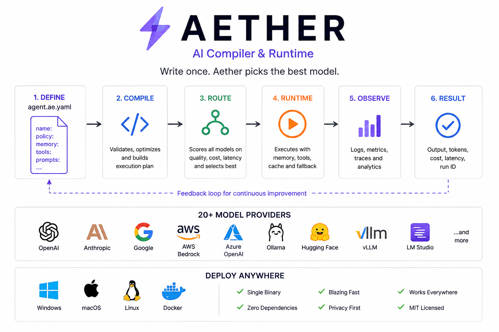
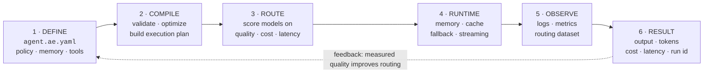
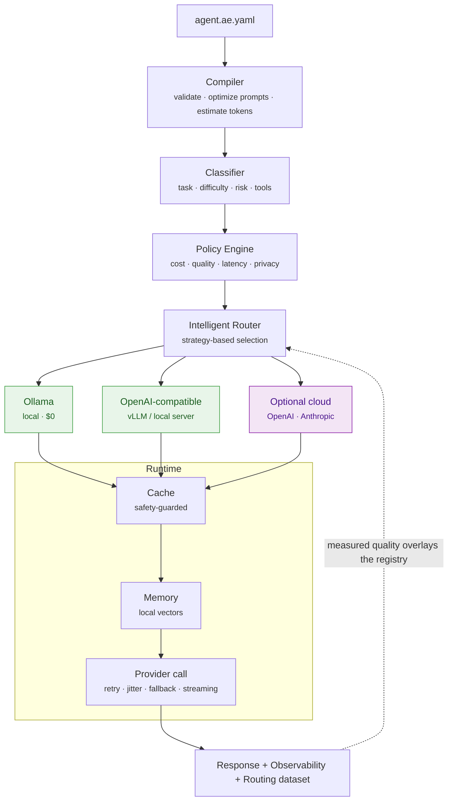
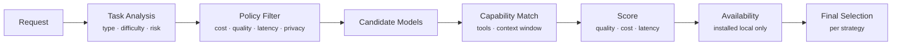
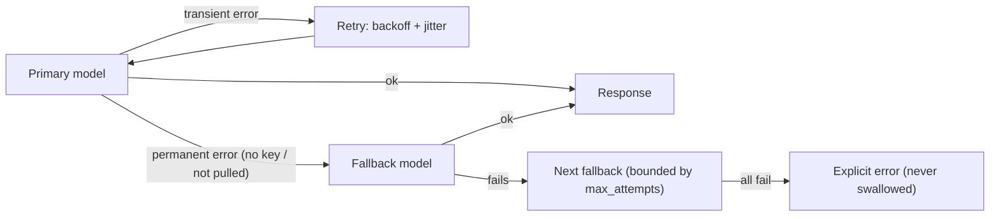

<p align="center">
  
</p>

<h1 align="center">Aether ⚡ — Policy Compiler & Free-First Router for AI</h1>

> You write a **policy**. Aether classifies the task, filters models by your
> constraints, and routes to the best-fitting model — preferring **local** models
> so your default path costs **$0** and stays private.

**Single static binary. Zero external Go dependencies. Local-first. Works offline once a model is pulled.**

Aether is not another API wrapper. It is a small compiler + runtime that turns
`agent.ae.yaml` into an execution plan and picks *which model, strategy, and
fallback path* to use for each workload.

## How it flows

The lifecycle of one request — **define → compile → route → run → observe →
result**, with measured results feeding back to improve future routing:



---

## Why

Most "LLM gateways" make you hardcode a model. Aether inverts that: you declare
what you care about (quality, cost, latency, privacy), and the router decides.
Because the default is **local-first**, a developer with a laptop and **no
budget** can run the whole thing — no OpenAI/Anthropic/cloud account required.

Optional cloud providers exist behind the same interface, but are **never
required** and are excluded entirely under a `privacy: local` policy.

---

## Production-ready

Aether has been through a full engineering-hardening pass. Highlights:

- **Safe artifacts** — the `.ae` format is bounds-checked and integrity-verified
  (full SHA-256), with size and zip-bomb limits. A corrupt artifact returns an
  error, never a panic (fuzz-tested). Compilation is **deterministic**.
- **Strict specs** — the YAML parser rejects tabs, duplicate keys, and unknown
  fields with line-numbered errors instead of silently mis-parsing.
- **Reliable runtime** — context-aware execution (cancel with Ctrl-C), typed
  retryable-vs-permanent errors, bounded retries with jittered backoff, bounded
  caches, and concurrency-safe stores (race-clean).
- **Observability** — structured JSON logs (`AETHER_LOG_LEVEL`, quiet by
  default) with per-request execution IDs; metrics and a routing dataset.
- **Supply chain** — CI runs `go vet`, `go test -race`, coverage,
  [`govulncheck`](https://pkg.go.dev/golang.org/x/vuln/cmd/govulncheck), and
  secret scanning; releases are reproducible (`-trimpath`) and ship an SBOM +
  `SHA256SUMS`.

The complete finding-by-finding log is in
[`docs/ENGINEERING_AUDIT.md`](docs/ENGINEERING_AUDIT.md).

---

## Quick start ($0, no API key)

```bash
# 1. Install a free local model runtime (once)
#    https://ollama.com  — then:
ollama serve
ollama pull llama3.2            # ~2GB

# 2. Build Aether
go build -o aether ./cmd/aether

# 3. Scaffold, check your environment, and run — fully local
./aether init my-agent && cd my-agent
../aether doctor               # checks Go, Ollama, models, permissions (with fixes)
../aether build
../aether run --local --message "Explain caching in one paragraph"
```

No Ollama yet? Everything still works with the mock model:

```bash
aether run --mock --message "Hello"
```

---

## The policy (what you actually write)

```yaml
# agent.ae.yaml
name: my-agent
version: "1.0.0"

policy:
  quality:   { minimum: 0.80 }     # absolute quality floor (0..1)
  cost:      { max_per_run: 0.01 } # USD budget per run
  latency:   { max_p95: 2000 }     # ms
  privacy:   { level: local }      # HARD guarantee: never calls cloud
  execution: { local_first: true } # prefer an installed local model
  fallback:  { enabled: true, max_attempts: 2 }

prompts:
  system: You are a helpful assistant.
  user_template: "{user_message}"
```

The original flat form (`quality: balanced`, `max_cost_per_run: 0.05`,
`latency: fast`, `prefer_local: true`) still works — both are supported.

---

## Routing strategies

```bash
aether run --strategy auto       # balanced quality/cost/latency (default)
aether run --strategy cheapest   # lowest cost that meets policy
aether run --strategy fastest    # lowest latency that meets policy
aether run --strategy best       # highest quality that meets policy
aether run --strategy local      # local-only ($0, private)
aether run --local               # same as --strategy local
aether run --stream              # stream tokens as they generate
```

The pipeline is fully transparent — `aether test` shows every candidate and why
it was kept or rejected:

```
Intelligent Routing Analysis
==============================================================================
Task: coding         Difficulty: 0.65  Risk: moderate Reasoning:false Tools:false
Strategy: auto       Min-quality: 0.82  Budget: $0.010000  Max-latency: 3000ms
------------------------------------------------------------------------------
Model               Quality   Prov     Cost $   Latency  Status
------------------------------------------------------------------------------
qwen2.5                0.81    est    0.00000    2200ms  ✗ quality 0.81 < required 0.82
gpt-4o-mini            0.70    est    0.00024     700ms  ✗ quality 0.70 < required 0.82
claude-sonnet-3-5      0.88    est    0.00608    2000ms  ★ SELECTED
```

`Prov` is the quality **provenance**: `meas` (measured by `aether evaluate` on
your machine), `est` (estimated prior), or `unk` (unknown). Aether never
presents an estimate as a measurement.

---

## Free, offline evaluation

Aether ships an original benchmark dataset and a heuristic scorer that runs with
**no paid API**. It measures your locally-available models and feeds the results
back into routing.

```bash
aether evaluate                       # uses installed local models + built-in dataset
aether evaluate my-dataset.json       # bring your own prompts
```

Example — an **actual run** on an Apple Silicon Mac (your numbers will vary by
hardware and which models you pulled; nothing here is hand-written):

```
AETHER MODEL EVALUATION
================================================================
Dataset: aether-basic-v1
Tasks:   44

Model            Quality        P95    Success   Tokens
----------------------------------------------------------------
phi3             91.7%       5039ms      100%  5166/meas
gemma2           83.0%       3745ms      100%  4185/meas
----------------------------------------------------------------
Recommendation:
  phi3

Reason:
  Best MEASURED quality on this dataset. Not a claim about any
  other workload — measure your own prompts to route on your data.
```

Note that `gemma2`'s *estimated* prior (0.71) and `phi3`'s (0.66) both ranked
below their *measured* scores here — which is the whole point of measuring
instead of trusting vendor priors. A model installed under a non-default tag
(e.g. `qwen2.5:3b` when the catalogue key is `qwen2.5`) is reported as failed,
not silently scored — honest by construction.

Measured scores are written to `.aether/observability/benchmarks.json` and
overlay the registry, so future `aether run`/`aether test` route on **your**
data, not vendor claims.

> **Honesty note:** the built-in scorer is a deterministic keyword/regex
> heuristic — a proxy for quality, clearly labelled as such. It is not a human
> judgment or an LLM-as-judge. Items with no deterministic expectation are
> reported as *unscorable*, never fabricated.

---

## Reproducible benchmark: Aether routing vs. "always strongest"

The point of routing is to do at least as well as always picking the strongest
model, while spending less (cost/latency/compute). To reproduce on your machine:

```bash
ollama pull llama3.2 && ollama pull qwen2.5     # two local models
aether evaluate                                  # measures both on aether-basic-v1
# Compare: routing per-task (aether test on varied prompts) vs. forcing the
# strongest model on every task (--strategy best). Routing should match quality
# on easy tasks while using the smaller/faster model, lowering p95 and compute.
```

Because results depend on which models you pulled and your hardware, this repo
does **not** ship fabricated numbers. Run the command above to generate a report
you can trust. See `evaluation/datasets/aether-basic-v1.json` (44 original,
CC0 prompts across 10 categories) — add your own.

---

## Architecture

Everything below the router is provider-agnostic — local and cloud backends are
peers behind one `ModelProvider` interface. The default path never leaves your
machine.



**The routing pipeline** (what "3 · ROUTE" expands to):



**Fallback & resilience** (never a retry storm):



- **Provider abstraction** (`internal/provider`): every backend implements one
  small `ModelProvider` interface (`Generate`, `Stream`, `Capabilities`). Local
  and cloud are peers; the runtime has zero provider-specific code.
- **Model registry** (`internal/models`): capabilities, pricing, and quality
  with explicit `measured/estimated/unknown` provenance.
- **Classifier** (`internal/classifier`): offline heuristic task analysis
  (type, difficulty, risk, reasoning/tools) behind a swappable interface.
- **Policy engine** (`internal/policy`): enforces cost/quality/latency/privacy
  *before* selection; `privacy: local` is a hard cloud-exclusion guarantee.
- **Router pipeline** (`internal/router`): task → policy filter → capability /
  quality / cost / latency scoring → selection, with strategies.
- **Runtime** (`internal/runtime`): cache (with time-sensitive/personal/secret
  safeguards) → memory → provider call with retry+jitter+fallback → streaming.

---

## CLI reference

| Command | Description |
|---------|-------------|
| `aether init [name]` | Scaffold a new project |
| `aether build` | Compile spec → `.ae` artifact |
| `aether run` | Execute (free-first: prefers installed local model) |
| `aether run --local / --strategy S / --stream` | Force local / pick strategy / stream |
| `aether models` | Local (Ollama) + catalogue models with quality provenance |
| `aether doctor` | Check Go, Ollama, models, permissions — with fixes |
| `aether evaluate [dataset]` | Offline model benchmark (measures real quality) |
| `aether inspect [artifact]` | Show a compiled `.ae` plan and routing |
| `aether test` | Validate spec + show the routing decision |
| `aether benchmark --runs N` | Runtime cost/latency/quality benchmark |
| `aether stats` | Observability report |
| `aether publish/pull/search` | Local artifact registry |

---

## Build from source

Requires Go 1.26+. Zero external dependencies.

```bash
go build -o aether ./cmd/aether
go test -race ./...         # 109 tests (incl. fuzz), all offline, race-clean
gofmt -l internal cmd tests # formatting check (CI-enforced)
go vet ./...
```

---

## What Aether does NOT require

No OpenAI/Anthropic/Gemini credits · no AWS/GCP/Azure · no paid database ·
no Pinecone/Weaviate · no Datadog/Grafana Cloud · no credit card. Cloud
integrations are optional adapters, off by default.

## License

MIT © Orbis-Mind. Benchmark dataset: CC0 (original content).
